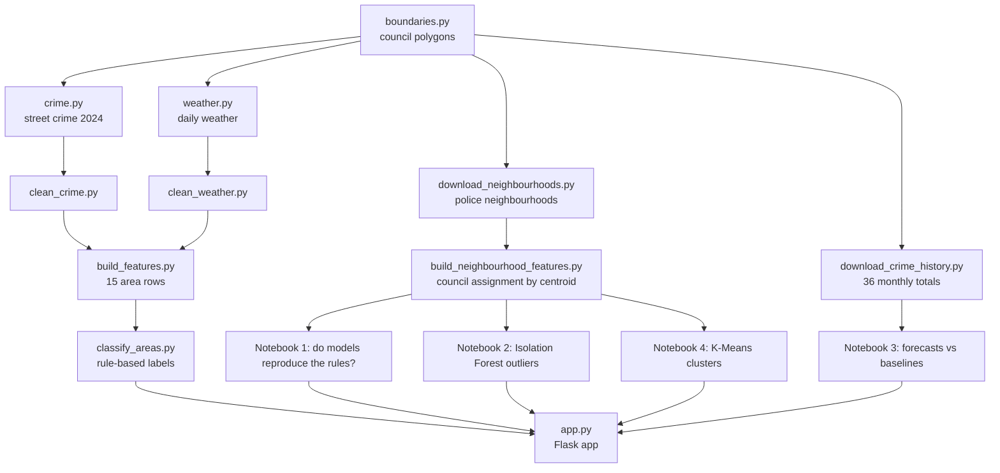

# LiveSafe: area risk classification for 15 UK councils

A Flask web app and analysis pipeline that describes 15 local authority areas in England and
Wales by recorded crime, crime trend and weather exposure, using open data for 2024.
Final-year project, UFCEKP-30-3, UWE Bristol.

> **This repository was audited and corrected after submission.** The original neighbourhood
> analysis placed most neighbourhoods in the wrong council, the classifier accuracies were
> circular, and the forecasts were reported without a baseline. All three are fixed and the
> numbers below are the corrected ones. See [What I fixed after submission](#what-i-fixed-after-submission).


## 1. Problem

Someone choosing where to live, invest or direct council resources wants a plain description
of an area: how much crime is recorded, whether it is rising, and which neighbourhoods stand
out. LiveSafe gives each council area a small set of **rule-based labels** that can be
explained in one sentence each, and uses machine learning only to check and explore those
labels. It is **not** a predictive policing tool and makes no claim about where crime will happen.

## 2. Data

| Source | What | Used for |
|---|---|---|
| [data.police.uk API](https://data.police.uk/docs/) | Street-level crime, January to December 2024 (669,646 records) | Area and neighbourhood features |
| data.police.uk API | Neighbourhood lists and boundaries per police force | Neighbourhood units |
| data.police.uk API | Monthly totals, October 2023 to September 2026 (36 months) | Forecast evaluation only |
| [ONS Open Geography](https://geoportal.statistics.gov.uk/) | Local Authority District boundaries, December 2024 | Council polygons |
| [Meteostat](https://meteostat.net/) | Daily temperature and rainfall | Weather exposure labels |
| English Indices of Deprivation 2019 | IMD scores | External comparison |

Raw downloads are rebuilt by the scripts and are not committed. Cleaned and processed tables
are in `data/cleaned/` and `data/processed/`.

## 3. Pipeline



## 4. Methods and corrected results

Every number in this section is read from a file in `data/processed/`, named in each part.

### 4.1 Area labels (rule-based, primary)

Each of the 15 areas gets four labels from fixed rules (`classify_areas.py`): crime intensity
(quartiles of average monthly crimes), crime pattern (violent and property shares), crime
trend (slope and variability over 2024) and weather exposure (rainfall and cold months).
The labels are combined into an overall profile such as "Stable Low-Risk Area".
Output: `area_classified.parquet`.

As an external comparison, the area crime ranking has a Spearman correlation of 0.74
(p = 0.002) with the IMD deprivation ranking (`imd_validation.csv`).

### 4.2 Neighbourhoods

Police neighbourhoods are assigned to the council that contains their centroid. After the
fix described below there are **388 neighbourhoods** across the 15 councils
(`neighbourhood_features.parquet`). Coverage is uneven: from 64 in County Durham to 3 in
Norwich (`neighbourhood_scope_fix.csv`), because police forces draw neighbourhoods at very
different sizes.

Each neighbourhood is labelled High, Moderate or Lower Crime by where its average monthly
crime count falls within its own council (cut at the 33rd and 66th percentiles).

### 4.3 Can a model reproduce the rule labels? (Notebook 1)

This is a consistency check, not prediction: the label is computed from
`avg_monthly_crimes`, and the models are given `avg_monthly_crimes`. Results on 388
neighbourhoods, 5-fold cross-validation (`ml_model_comparison.csv`):

| Model | Agreement with the rule label |
|---|---:|
| Majority class (baseline) | 34.8% |
| Random Forest, all 13 features | 74.7% ± 3.5 |
| Gradient Boosting, all 13 features | 86.4% ± 2.7 |
| Random Forest, without the crime count | 44.6% ± 9.0 |
| Gradient Boosting, without the crime count | 46.4% ± 5.2 |

Reading: with the crime count, the models partly re-learn the thresholds (not fully, because
thresholds differ by council). Without it, they are about 10 points above the baseline, so
crime mix, trend and council context say little about which third of its council a
neighbourhood falls in. The rule-based labels stay the primary output.

### 4.4 Outlier neighbourhoods (Notebook 2)

An Isolation Forest flags neighbourhoods with unusual crime volume, mix or trend. It flags 31
of 388 across all councils, and all 6 Leeds and all 5 Sheffield neighbourhoods
(`anomaly_summary.csv`). That last result is a warning, not a finding: those forces draw a
few very large neighbourhoods, so their raw counts are high. See Limitations.

### 4.5 Clusters (Notebook 4)

K-Means with K = 4 on the same four features gives clusters of 128, 179, 69 and 12
neighbourhoods; the smallest averages 1,275 crimes a month against 77 to 168 for the others
(`cluster_comparison_neighbourhoods.csv`), which again mostly separates the very large
neighbourhoods.

### 4.6 Forecasts against baselines (Notebook 3)

The app projects each area's monthly crime 3 months ahead with a straight line fitted to the
last 10 months. That method is compared with baselines that need no model, using
rolling-origin evaluation on 36 months for all 15 councils: 22 forecast dates per council,
each scored 1 to 3 months ahead (`forecast_baseline_overall.csv`, per council in
`forecast_baseline_comparison.csv`).

| Method | Mean MAE (crimes/month) | MAE as % of an average month | Councils where best |
|---|---:|---:|---:|
| Linear trend, last 10 months (the app's method) | 477.3 | 13.5% | 0 |
| Linear trend, all months | 330.0 | 9.7% | 1 |
| Last value (next month = this month) | 295.6 | 8.4% | 3 |
| Seasonal naive (same month last year) | 216.0 | 6.4% | 11 |

Reading: the linear trend is the worst of the four and is beaten by "same month last year"
in most councils. Recorded crime is seasonal, and a straight line cannot represent that. The
app shows the baseline error next to the linear model's, and its projections should be read
as a rough direction, not a forecast.

## 5. Screenshots

| Area profile | Rankings |
|---|---|
|  |  |

The analysis page, with the agreement check, outliers and the forecast comparison:
[docs/analysis.png](docs/analysis.png).

## 6. What I fixed after submission

I audited the project against its own files and found four problems.

**1. Most neighbourhoods were in the wrong council.**
*What was wrong.* Neighbourhood lists come per police force, and each force's whole list was
labelled with one study council. Devon and Cornwall Police, for example, was downloaded once
for Exeter and once for Cornwall, and all 213 of its neighbourhoods were labelled with each.
*How I found it.* `anomaly_summary.csv` had identical rows for Cardiff and Swansea, and for
Cornwall and Exeter. Checking every neighbourhood centroid against the council polygons
showed that only 388 of 1,527 rows lay inside their labelled council; 416 rows were
duplicates and 1,006 lay outside all 15 councils (`neighbourhood_scope_fix_summary.json`).
*What changed.* Each neighbourhood is now assigned by a spatial join of its centroid to the
council polygons (`council_assignment.py`), and the downloader does this at download time.
The neighbourhood count went from 1,527 to 388, and every neighbourhood-level result was
regenerated. `tests/test_scope.py` fails on the old data and passes on the new.

**2. The classifier accuracies were circular.**
*What was wrong.* The original notebook reported 92.8% and 96.7% test accuracy (the original `ml_model_comparison.csv`, in the git history) for
predicting a label that was computed from one of the model's inputs.
*What changed.* Notebook 1 now states the target, reports agreement with the rule next to a
majority-class baseline, and cross-validates the version without the crime count (table in 4.3).

**3. The forecast was reported without a baseline.**
*What was wrong.* A linear trend on 10 training months was tested on 2 months and reported
alone (mean MAE 547.7 across areas, `forecast_metrics.csv`).
*What changed.* Rolling-origin evaluation on 36 months against two baselines (table in 4.6).
The honest result is that the linear trend loses.

**4. The project could not be installed.**
`requirements.txt` lacked Flask, SciPy, Meteostat and Shapely. It now installs in a fresh
virtual environment, and two notebooks that failed on current Matplotlib are fixed.

## 7. Limitations

- **Raw counts, not rates.** Nothing is divided by population. Large councils and large
  neighbourhoods look "high crime" for that reason alone. This is the biggest weakness.
- **Neighbourhood sizes differ by force**, so neighbourhoods are not comparable across
  councils, and 5 councils have fewer than 10. Within-council labels on 3 to 8
  neighbourhoods mean little.
- **Centroid assignment is approximate.** The centroid is the mean of the boundary points,
  and a neighbourhood that straddles a council border is assigned wholly to one side.
- **Neighbourhood features were re-derived, not re-downloaded.** The corrected tables are
  built from the per-neighbourhood aggregates already in the repository; the corrected
  downloader has not been run end to end.
- **Council polygons are simplified to 50 points** for the police API, so area totals are
  approximate at the edges.
- **One year of data** for the labels; trend labels come from 12 monthly points.
- **No non-circular prediction task.** Predicting next quarter's class from this quarter's
  features needs monthly counts per neighbourhood, which the repository does not keep.
- **The app's projections still use the linear trend**, the weakest method in 4.6.
- **Recorded crime is not crime.** It reflects reporting and recording practice.

## 8. Run it

```bash
pip install -r requirements.txt
python -m pytest          # 21 tests
python app.py             # http://127.0.0.1:5000
```

To rebuild from scratch (several hours of API calls):

```bash
python boundaries.py && python crime.py && python weather.py
python clean_crime.py && python clean_weather.py
python build_features.py && python classify_areas.py
python download_neighbourhoods.py && python build_neighbourhood_features.py
python download_crime_history.py
jupyter nbconvert --to notebook --execute --inplace Notebook*.ipynb
```

## 9. Repository layout

```
app.py, templates/, static/        Flask app
settings.py                        study councils, thresholds, paths
boundaries.py crime.py weather.py  downloads
clean_*.py build_features.py classify_areas.py     area pipeline
download_neighbourhoods.py build_neighbourhood_features.py council_assignment.py
download_crime_history.py forecast_evaluation.py   forecast evaluation
Notebook1..4                       analysis notebooks (write the files the app reads)
tests/                             scope, council assignment and forecast evaluation tests
data/processed/                    every table and figure quoted above
docs/                              screenshots
```
