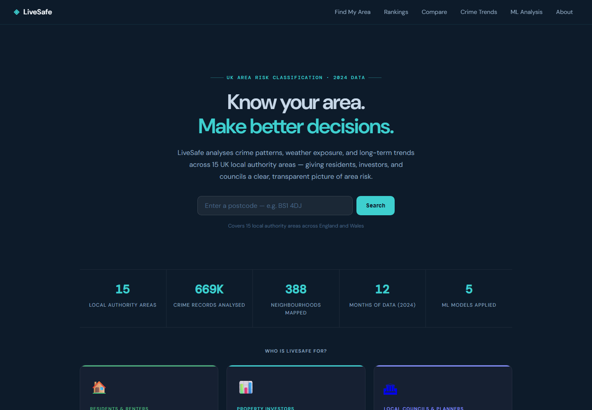
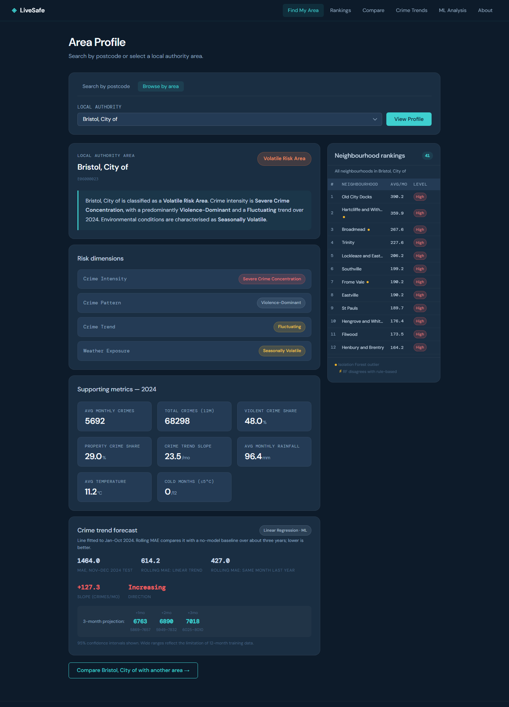
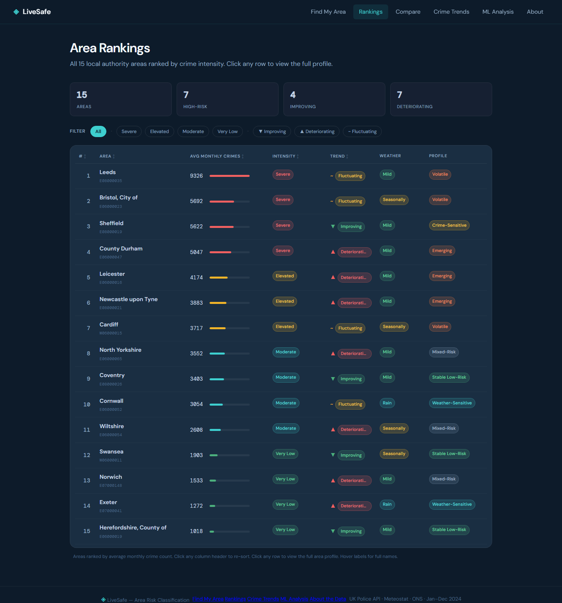

# LiveSafe: area risk classification for 15 UK councils

A Flask web app and analysis pipeline that describes 15 council areas in England and Wales by
recorded crime, crime trend and weather, using open data for 2024. My final-year project
(UFCEKP-30-3, UWE Bristol).



## Why I cared

Crime maps show thousands of dots, and dots are hard to read. I wanted something that
describes an area in a few plain sentences: how much crime is recorded, whether it is rising,
and which neighbourhoods stand out. After I submitted it, I checked the project against its
own files and found that three of its results were wrong.

## What I found

Simple rules describe an area better than the machine learning I put on top of them. The
straight-line forecast the app uses is the worst of four methods I compared: "same month last
year" beats it in 11 of 15 councils, with an average error of 6.35% of a month's crime against
13.52%. And without the crime count itself, two classifiers agree with the rule labels only
about 10 points more often than always guessing the commonest label.

I only learned this after submitting. Most neighbourhoods had been placed in the wrong council,
the classifier accuracies were circular, and the forecast had no baseline. Everything below is
the corrected version. [What I fixed after submission](#what-i-fixed-after-submission) explains
each problem.

## Two explanations for the classifier

My original notebook reported 92.8% and 96.7% test accuracy. Either the models had learned
something real about neighbourhoods, or they had re-learned the rule from the crime count the
label is computed from. The second held. Results on 388 neighbourhoods, 5-fold
cross-validation ([`ml_model_comparison.csv`](data/processed/ml_model_comparison.csv)):

| Model | Agreement with the rule label |
|---|---:|
| Majority class (baseline) | 34.8% |
| Random Forest, all 13 features | 74.7% ± 3.5 |
| Gradient Boosting, all 13 features | 86.4% ± 2.7 |
| Random Forest, without the crime count | 44.6% ± 9.0 |
| Gradient Boosting, without the crime count | 46.4% ± 5.2 |

With the crime count, the models partly re-learn the thresholds (not fully, because the
thresholds differ by council). Without it, crime mix, trend and council context say little
about which third of its council a neighbourhood falls in. So the rule-based labels stay the
main output, and the models only check them.

## How it works

| Source | What | Used for |
|---|---|---|
| [data.police.uk API](https://data.police.uk/docs/) | Street-level crime, January to December 2024 (669,646 records) | Area and neighbourhood features |
| data.police.uk API | Neighbourhood lists and boundaries per police force | Neighbourhood units |
| data.police.uk API | Monthly totals, October 2023 to September 2026 (36 months) | Forecast evaluation only |
| [ONS Open Geography](https://geoportal.statistics.gov.uk/) | Local Authority District boundaries, December 2024 | Council polygons |
| [Meteostat](https://meteostat.net/) | Daily temperature and rainfall | Weather exposure labels |
| English Indices of Deprivation 2019 | IMD crime domain scores (approximate, typed in by hand) | External comparison |

- **Area labels.** Each council gets four labels from fixed rules: crime intensity (quartiles
  of average monthly crimes), crime pattern (violent and property shares), crime trend (slope
  and variability over 2024) and weather exposure (rainfall and cold months). Together they
  give a profile such as "Stable Low-Risk Area".
- **Neighbourhoods.** Each police neighbourhood goes to the council that contains its centroid,
  which gives 388 across the 15 councils. Coverage is uneven, from 64 in County Durham to 3 in
  Norwich, because police forces draw neighbourhoods at very different sizes. Norwich's three
  hold only 57.4% of the council's recorded crime
  ([coverage table](data/processed/neighbourhood_coverage.csv)). Each neighbourhood is
  labelled High, Moderate or Lower Crime by where it falls within its own council.
- **Outliers and clusters.** An Isolation Forest flags 31 of 388 neighbourhoods, including all
  6 in Leeds and all 5 in Sheffield. K-Means with K = 4 gives clusters of 128, 179, 69 and 12;
  the smallest averages 1,275 crimes a month against 77 to 168 for the others. I read both as
  a warning: they mostly pick out the forces that draw a few very large neighbourhoods.

Raw downloads are rebuilt by the scripts. Cleaned and processed tables are in `data/cleaned/`
and `data/processed/`, and every number in this README is read from one of them.

## The forecast

The app projects each council's monthly crime 3 months ahead with a straight line through the
last 10 months. I compared it with methods that need no model, on 36 months for all 15
councils: 22 forecast dates per council, each scored 1 to 3 months ahead
([`forecast_baseline_overall.csv`](data/processed/forecast_baseline_overall.csv)).

| Method | Mean error (crimes/month) | As % of an average month | Councils where best |
|---|---:|---:|---:|
| Straight line, last 10 months (the app's method) | 477.3 | 13.52% | 0 |
| Straight line, all months | 330.0 | 9.65% | 1 |
| Last value (next month = this month) | 295.6 | 8.37% | 3 |
| Same month last year | 216.0 | 6.35% | 11 |

Recorded crime is seasonal, and a straight line can't follow that. The app now shows the
baseline's error next to the line's.

The app's projections are for January to March 2025, which is now in the past, so the app
shows each one next to the count recorded later. Of the 45 projections, the recorded count
fell inside the 95% interval for 22, the mean error was 19.7% of the recorded count, and 43
were too high ([summary](data/processed/forecast_projection_backtest_summary.json)).

The area crime ranking has a Spearman correlation of 0.74 (p = 0.002) with the IMD crime
domain. I don't count that as validation: the scores were typed in by hand, not read from the
published file, and the IMD crime domain is itself built from police-recorded crime.

| Area profile | Rankings |
|---|---|
|  |  |

The analysis page shows the agreement check, outliers and forecast comparison
([screenshot](docs/analysis.png)).

## What I fixed after submission

**Most neighbourhoods were in the wrong council.** Neighbourhood lists come per police force,
and I had labelled each force's whole list with one study council. Devon and Cornwall Police
was downloaded once for Exeter and once for Cornwall, and all 213 of its neighbourhoods were
labelled with each. I noticed because the outlier table had identical rows for Cardiff and
Swansea, and for Cornwall and Exeter. Checking every centroid against the council polygons
showed that only 388 of 1,527 rows lay inside their labelled council; 416 were duplicates and
1,006 lay outside all 15 councils. Neighbourhoods are now assigned by a spatial join at
download time, every neighbourhood result was regenerated, and `tests/test_scope.py` fails on
the old data and passes on the new.

**The classifier accuracies were circular.** The 92.8% and 96.7% (in the original
`ml_model_comparison.csv`, in the git history) came from predicting a label computed from one
of the inputs. The notebook now states the target and reports agreement next to a baseline,
with the version without the crime count.

**The forecast had no baseline.** A straight line on 10 training months was tested on 2 months
and reported alone (mean error 547.7). It is now compared with baselines over 36 months, and it
loses.

**The project could not be installed.** `requirements.txt` lacked Flask, SciPy, Meteostat and
Shapely. It now installs in a fresh environment, and two notebooks that failed on current
Matplotlib are fixed.

The lesson I took: read your own outputs as if someone else wrote them. Two identical rows
were enough to find the biggest error.

## Limits

- **Raw counts, not rates.** Nothing is divided by population, so large councils and large
  neighbourhoods look "high crime" for that reason alone. This is the biggest weakness.
- **Neighbourhoods aren't comparable across forces**, and 5 councils have fewer than 10.
  Labels within a council of 3 to 8 neighbourhoods mean little.
- **Centroid assignment is approximate.** A neighbourhood that straddles a council border goes
  wholly to one side.
- **The neighbourhood fix was re-derived** from aggregates already in the repository. The
  corrected downloader has not been run end to end.
- **One year of data** for the labels, and council polygons simplified to 50 points for the
  police API, so totals are approximate at the edges.
- **No non-circular prediction task.** Predicting next quarter's class needs monthly counts per
  neighbourhood, which the repository doesn't keep.
- **Recorded crime is not crime.** It reflects reporting and recording practice.

## Run it

```bash
pip install -r requirements.txt
python -m pytest          # 22 tests
python app.py             # http://127.0.0.1:5000
```

To rebuild from scratch (several hours of API calls):

```bash
python boundaries.py && python crime.py && python weather.py
python clean_crime.py && python clean_weather.py
python build_features.py && python classify_areas.py
python download_neighbourhoods.py && python build_neighbourhood_features.py
python download_crime_history.py
jupyter nbconvert --to notebook --execute --inplace Notebook*.ipynb
```

```
app.py, templates/, static/        Flask app
settings.py                        study councils, thresholds, paths
boundaries.py crime.py weather.py  downloads
clean_*.py build_features.py classify_areas.py     area pipeline
download_neighbourhoods.py build_neighbourhood_features.py council_assignment.py
download_crime_history.py forecast_evaluation.py   forecast evaluation
Notebook1..4                       analysis notebooks (write the files the app reads)
tests/                             scope, council assignment and forecast evaluation tests
data/processed/                    every table and figure quoted above
docs/                              screenshots
```
